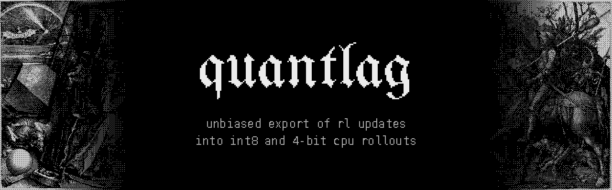
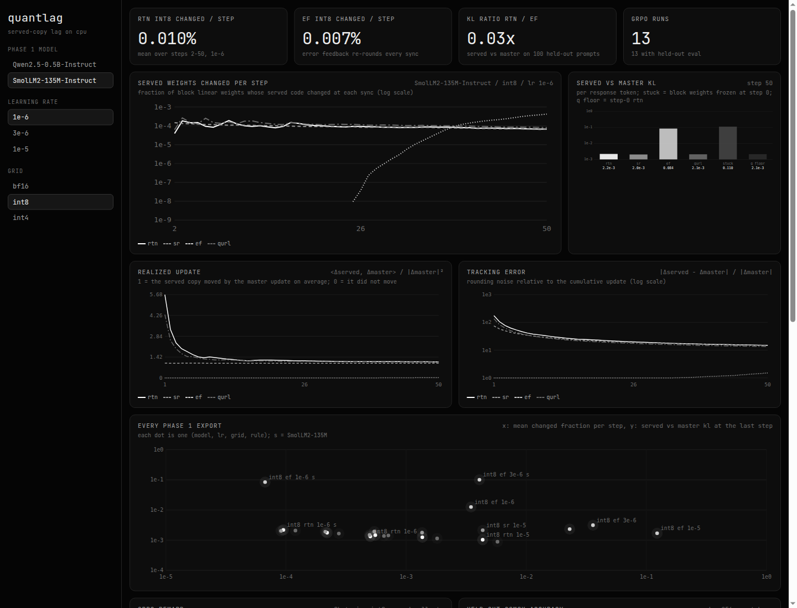
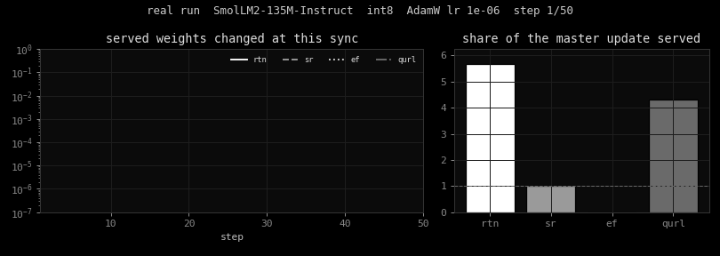
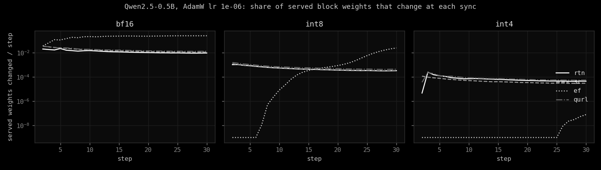
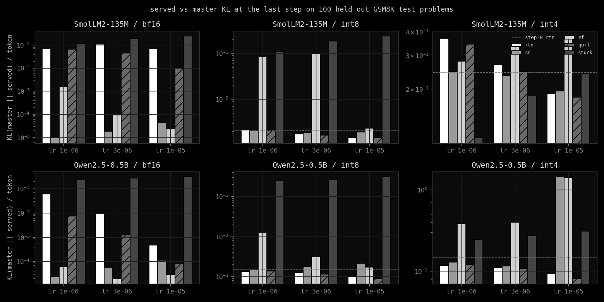
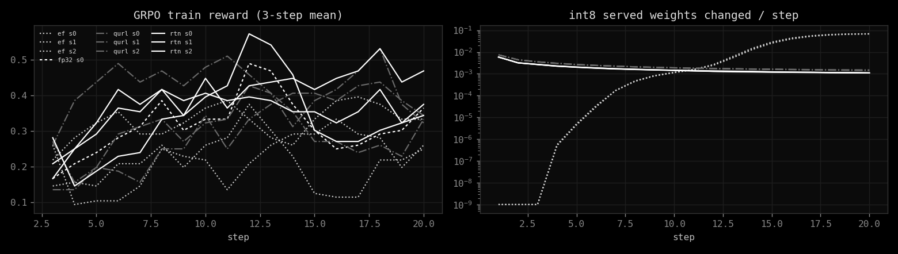

quantlag measures what happens to RL policy updates when the rollouts come from an int8 or
4-bit copy of the policy on a CPU. It compares round-to-nearest export against stochastic
rounding, error feedback and QuRL's invariant scaling, on real AdamW updates and real GRPO
runs with Qwen2.5-0.5B-Instruct and SmolLM2-135M-Instruct. Every number here comes from a
small-scale run on one 8-core CPU; none of it used a GPU.

`#ai-frontier-research` `#reinforcement-learning` `#grpo` `#quantization` `#stochastic-rounding` `#training-inference-mismatch` `#cpu-inference`

[](LICENSE)
[](docs/REPORT.md)
[](results)
[](.github/workflows/ci.yml)



## The Lag

RL keeps fp32 master weights in the optimizer and samples from a cheaper served copy. If that
copy is re-made from the master with round-to-nearest, any change smaller than half a grid
step is thrown away. Fair Cast showed that for bf16 on GPU. Integer grids are far coarser
than bf16, so the expectation was that int8 and int4 copies would lag even more.

The bf16 part holds up here. With Qwen2.5-0.5B-Instruct at AdamW lr 1e-6, RTN served only
22% of the master's cumulative update after 30 steps, and its KL to the master was 0.060 per
token. Stochastic rounding served 100% of it, at a KL of 2.5e-5.



## The Fix

`quantlag/export.py` holds four ways to refresh the served copy after each optimizer step.
`rtn` re-quantizes the master. `sr` rounds the update onto the grid stochastically, so the
served copy is right on average. `ef` keeps the part of the update that did not fit in a
residual and adds it back next time, so nothing is lost for good. `qurl` rescales the
RMSNorm weights and the projections behind them so updates are larger in grid units, then
uses RTN. Integer scales are frozen at the start, as in a deployed copy patched in place.

Training uses the served copy for both the rollouts and the loss, with a straight-through
overlay, so the gradient lands on the fp32 master.



## The Results

The hypothesis fails for int8. Under 1% of int8 weights change per sync, as predicted, but
that is not lag: RTN from the fp32 master still serves 100-110% of the cumulative update at
every learning rate, and its KL to the master (about 1e-3 per token) is the static
quantization error, the same as stochastic rounding. Error feedback on the update made the
int8 copy worse, not better. At 4 bits the static error (KL 0.1-0.4) swamps any export rule.

In GRPO on GSM8K (Qwen2.5-0.5B-Instruct, 20 steps, 500 test problems, small scale):

| arm | seeds | step 0 | step 20 mean (range) |
|---|---|---|---|
| fp32 reference | 1 | 28.8% | 44.0% |
| int8 RTN | 3 | 31.2% | 42.1% (38.6-44.0) |
| int8 EF | 3 | 31.2% | 28.4% (23.6-34.2) |
| int8 QuRL | 3 | 30.8% | 39.1% (37.4-40.8) |

RTN int8 rollouts trained about as well as full precision. EF rewrote about 7% of the int8
weights at every sync and lost 14 points. The bf16 lag from Fair Cast does reproduce, and
stochastic rounding fixes it there.

| | |
|---|---|
|  |  |

The method, every table and the limitations are in [docs/REPORT.md](docs/REPORT.md). The raw
per-step numbers are in [results/](results) and the tables in
[results/summary.md](results/summary.md).

## Install

```sh
git clone https://github.com/Sebastianrodaaa/quantlag && cd quantlag
pip install torch --index-url https://download.pytorch.org/whl/cpu && pip install -r requirements.txt
python3 test_quantlag.py                 # dry run: real weights, real GSM8K, a few minutes
make lag MODELS=HuggingFaceTB/SmolLM2-135M-Instruct   # phase 1, SmolLM2, 3 learning rates
make lag-split                           # phase 1, Qwen: train once per lr, replay per grid
make repro ARM=ef SEED=0                 # one phase 2 GRPO run
python3 scripts/plots.py && python3 -m http.server 8000   # then open localhost:8000/app/
```

It downloads the two models and GSM8K into `~/.cache/huggingface` and writes only to
`results/` and `docs/screenshots/` in the checkout. The Qwen phase 1 target keeps a
temporary trajectory (about 2 GB per step) in `results/traj_*` and deletes it when done.
To undo, delete the checkout and the two model folders under `~/.cache/huggingface/hub`.

## The Name

Lag is the gap between the policy being trained and the policy writing its data. Quant is the
grid that opens the gap. Together they name the thing being measured, which seemed fair for a
project that is mostly measurement.

## Inspirations

quantlag starts from Fair Cast ([arXiv 2610.41073](https://arxiv.org/abs/2610.41073v1)) and
QuRL ([arXiv 2602.13953](https://arxiv.org/abs/2602.13953v1)). The full list, with stochastic
rounding and error-feedback compression, is under Related work in
[docs/REPORT.md](docs/REPORT.md#related-work).

## License

MIT. The models, the dataset, the font and the engravings in the banner keep their own terms,
listed in [NOTICE.md](NOTICE.md).
